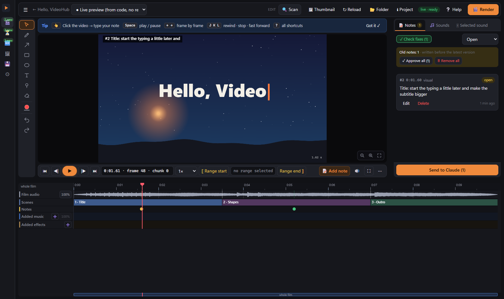
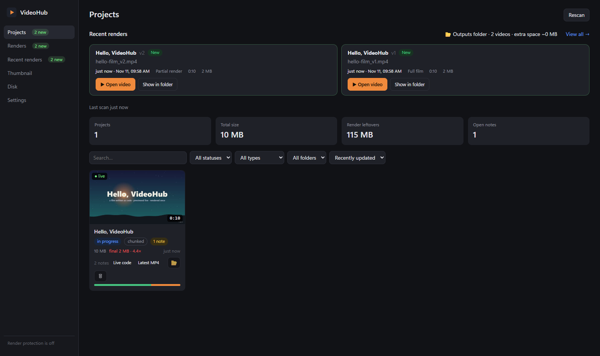
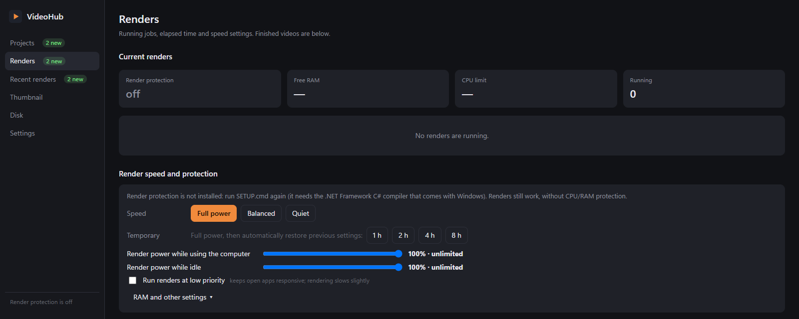

# VideoHub for Arch Linux

> **This is the Arch Linux port of [TensaikunYT/Videohub](https://github.com/TensaikunYT/Videohub)**, published here as
> [`veetl5/VideoHubForArch`](https://github.com/veetl5/VideoHubForArch). It is a vibe-coded port: it is built for and
> tested on Arch Linux, and other distributions should work when they carry the same tools, but that is not guaranteed.
> AMD VAAPI GPU encoding is **not** implemented; NVENC and Intel Quick Sync are.

**A local review studio and render queue for videos that Claude Code writes as code.**
You ask Claude Code for a video; it builds the film as a web page that draws every frame in code. VideoHub plays that
film straight from its code — no render — so you can watch it, step through frames, draw on a frame and write what is
wrong. One click sends your notes to Claude, Claude fixes the code, the open preview reloads by itself, and only when
you are happy do you render — once, in a queue that keeps your PC usable, and later re-rendering only the seconds that
changed. It is for people who make explainers, shorts and animations with Claude Code and are tired of rendering a
whole film to check one fix.

> **Arch Linux port.** This branch replaces VideoHub's Windows parts (PowerShell, Recycle Bin, Explorer, Edge, registry) with Linux ones: `gio trash`, `xdg-open`, `notify-send`, `zenity`, `ps`/`taskset`, XDG autostart. Details and limits: [docs/ARCH.md](docs/ARCH.md). It still runs on Windows where the code paths are shared.



## Features
- **Projects** — every film in your watched folders with its videos, versions, notes and disk use; a live cover for
  films that have no video yet.
- **Live preview, no render** — plays a film from its page (`window.renderOut(t)`), frame-accurate, with its sound,
  scenes and narration on a timeline. Changing the code reloads the open preview in place.
- **Review notes** — click or draw on any frame (or pick a frame range), type what is wrong. **Send to Claude** copies
  a short message; Claude reads the notes (time, frame, chunk, a close-up picture of your drawing) with `hub_notes`.
- **Check fixes** — a tour through the notes Claude marked fixed, with before/after; "Still there" sends one back.
- **Render queue** — one render at a time on the PC, waits for renders started elsewhere, progress and ETA, a
  render dialog with size/fps/workers/encoder, a copy to any folder, a desktop notification when it is done.
- **Partial re-render** — a film rendered in 2-second chunks re-renders only the chunks your notes touched, joins the
  film again and saves `film_vN.mp4` with the changed ranges; **Watch only the changes** plays just those.
- **Render protection** (optional agent) — see below.
- **Recent renders & outputs folder** — every finished render, newest first; each one also hard-linked into one
  outputs folder (a folder per day, no extra disk space).
- **Disk cleanup** — what can safely go (old chunks, silent copies, browser profiles, check frames, old versions) and
  why; always to the Recycle Bin or the archive, never deleted outright, always with your approval.
- **Sound** — mute/solo/levels per stem, remove the music, duck it under a range, add sounds from your library or
  disk on the timeline; renders use the rebuilt mix.
- **Thumbnail Studio** — sketch a thumbnail (posed mannequins, objects, text, camera/depth/light), send the brief to
  Claude, which makes the variants; annotate a variant, add the final text in code.
- **Agent tools (MCP)** — `hub_live`, `hub_notes`, `hub_note_update`, `hub_render`, `hub_job`, `hub_project`, `hub_workspace`,
  `hub_register_version`, `hub_cleanup`, `hub_thumb_*`; the same tools work from a shell (`node server/cli.js`).
- **Claude Code and opencode** — setup registers the MCP server, the review rule and the skill for both, for the
  terminal app and for the opencode desktop app (opencode shows the tools as `videohub_hub_*`); see
  [Works with opencode](#works-with-opencode).



### Render protection and speed
Built into the VideoHub server (plain Node plus `ps`, `taskset` and nice values; no extra program), it keeps long renders from
freezing the PC:
- **CPU limit** — every render VideoHub starts runs on a share of the processor cores (default 90 %) and at low
  priority; child processes (Chrome, ffmpeg) inherit both. Presets *Full power /
  Balanced / Quiet*, or "full power for 1–8 h".
- **RAM slow mode** — when free RAM falls below a threshold, the newest render slows down to a few cores at the lowest
  priority instead of being killed (the oldest keeps going unless RAM is critical) and speeds up again when RAM frees.
- **Slow down / Normal speed / Stop** per render on the Renders page, or for all of them at once.
- **One render at a time**, and the queue waits while another session is rendering; the Renders page also lists
  programs holding a lot of RAM (it never closes anything).
- **Partial re-renders** of only the fixed chunks, and per-render workers / encoder and fps options.
- **Faster renders, same quality** — the film template reads frames straight from the canvas (lossless, no JPEG) and
  encodes on the graphics card when the PC has one (NVIDIA NVENC, AMD AMF, Intel Quick Sync; else x264). On the test PC
  the example film rendered ~1.3× faster. Settings → *Render speed*; details and measurements:
  [docs/RENDER-SPEED.md](docs/RENDER-SPEED.md).
All thresholds are sliders on the Renders page (the RAM range scales with your machine's memory). Without the agent
VideoHub works the same; renders just run unprotected.



## Requirements

- Arch Linux (or another distro with the same tools)
- Node.js 22+ and npm: `sudo pacman -S nodejs npm`
- ffmpeg: `sudo pacman -S ffmpeg`
- A Chromium-family browser (renders drive it headless): `sudo pacman -S chromium`
- [Claude Code](https://claude.com/claude-code) and/or [opencode](https://opencode.ai) for the agent side
- Optional, each one only enables a feature: `xdg-utils` (open files/folders), `libnotify` (render notifications), `zenity` (folder picker), `glib2` or `trash-cli` (Trash), `pciutils` (GPU detection), `util-linux` (CPU limits via `taskset`)

## Install

```
git clone https://github.com/veetl5/VideoHubForArch VideoHub && cd VideoHub
./setup.sh --dry-run    # prints every step, changes nothing outside this folder
./setup.sh              # asks a few plain questions; Enter takes the recommended answer
```

`setup.sh` checks the requirements, runs `npm install`, writes `data/config.json` and the workspace folders (default `~/Documents/VideoHub`: `films`, `outputs`, `sounds`, `thumbnails`, `archive`), registers the `videohub` MCP server and the `videohub` skill for Claude Code **and for opencode**, optionally adds the review-before-render rule to `~/.claude/CLAUDE.md` and `~/.config/opencode/AGENTS.md`, an application-menu entry, start at login, and the example film. Every question is also a flag (see the top of `setup.sh`; `--yes` takes every recommended answer). Re-running keeps all answers. Start a **new** Claude Code or opencode session afterwards so it sees the tools. Open VideoHub from the menu or with `./videohub.sh`.

## Works with opencode

Claude Code and [opencode](https://opencode.ai) both work; `setup.sh` sets up whichever it finds (ask for opencode with
`--opencode yes`, skip it with `--opencode no`). For opencode it writes:

| What | Where |
|---|---|
| the MCP server `videohub` (`type: "local"`, `command: ["<node>", "<VideoHub>/server/mcp.js"]`), written as both `mcp.videohub` (opencode 1.x) and `mcp.servers.videohub` (V2, the desktop app) | `~/.config/opencode/opencode.json` (or `opencode.jsonc` if you already use one) |
| the review-before-render rule, between `<!-- videohub:begin/end -->` markers | `~/.config/opencode/AGENTS.md` |
| the `videohub` skill (with this install's path filled in) | `~/.config/opencode/skills/videohub/SKILL.md` |

Both files are edited in place: your other servers, models, permissions and comments stay exactly as they were, and a
file VideoHub cannot read is never rewritten (setup then prints the snippet to add by hand). A backup is kept next to
each file as `*.videohub-backup`.

**Two config shapes, one file.** opencode is moving its MCP servers from `mcp.<name>` (1.x, with `"enabled": true`) to
`mcp.servers.<name>` (V2 — what the docs and the desktop app read now, where `"disabled"` replaces `"enabled"`). Setup
writes **both**, so the same config works in either version and in both apps; the 1.x CLI simply ignores the extra
`servers` key. If a future client is strict about the other shape, `./setup.sh --opencode yes --opencode-schema v1` (or
`v2`) writes only that one, and `uninstall.sh` always removes both.

**One naming difference:** opencode prefixes MCP tools with the server name, so `hub_live` is `videohub_hub_live`,
`hub_notes` is `videohub_hub_notes`, and so on. The skill and the rule say this, so the agent picks the right names.
Without the MCP tools (any other agent), the same commands run from the shell:
`node "<VideoHub>/server/cli.js" hub_live '{"project":"<film folder>"}'`.

### The desktop app
The opencode desktop app (https://opencode.ai/download — `.deb`, `.rpm` or AppImage on Arch) keeps its settings in the
same `~/.config/opencode/`: the `opencode.json` and `AGENTS.md` that setup writes, and the same `skills/videohub` folder.
Nothing extra to install for VideoHub, with two things to know:

- **Restart the app after setup** (or after moving this folder): MCP servers are connected when the app starts, so an
  app that was already open keeps the old entry. Quit it completely and open it again.
- **The command is absolute** (`/usr/bin/node` …): a menu or AppImage launch has no shell `PATH`, and `node` alone would
  not be found. Setup writes `command -v node`; if you switch Node (nvm, a new `/usr/bin/node`), re-run
  `./setup.sh --opencode yes`.

In the app: the `/mcps` screen lists `videohub` as connected (or with its error), and a chat can call the tools as
`videohub_hub_live`, `videohub_hub_workspace`, … If the app was installed before this version of VideoHub, run
`./setup.sh --opencode yes` once — that adds the `mcp.servers.videohub` shape the desktop app reads, and keeps the
`mcp.videohub` entry the terminal app uses. `npm run opencode:check` reports both (`mcp.v1`, `mcp.v2`) plus whether it
found the desktop app (`desktop.found`), and `mcp.cliShape` names the shape the `opencode` on your `PATH` reads.

### Is it working?
1. `npm run opencode:check` (or `node scripts/opencode-config.mjs status`) — one JSON line, `"ready": true` when the
   MCP entry points at **this** folder, the rule block is in `AGENTS.md` and the skill file exists; otherwise `action`
   says what is missing and which `./setup.sh` flag fixes it.
2. `opencode mcp list` — shows the `videohub` server and its connection status; in a session, `/mcp` lists it too
   (MCP servers are connected at start-up, so open opencode **after** setup and after moving the folder). The desktop
   app has the same list on its `/mcps` screen — restart the app first.
3. `node server/mcp-selftest.js` — starts the same server the way opencode does and prints the 12 tools it exposes
   (`hub_live`, `hub_workspace`, …), so a broken server is visible without a chat.
4. In an opencode session, ask: *"Use the videohub_hub_workspace tool and tell me where my films go."* It should answer
   with your workspace and `films` folder. Then ask for a small film: VideoHub opens on it (live preview, no render).

## Your first film
1. If setup added the example film, its card is on the Projects page. Otherwise the page shows **Welcome to
   VideoHub** with your workspace and films folder (`<workspace>/films`): click **▶ Add the example film**.
2. Click its card: it opens in the **live preview**. Press Space, step with ← →, click on the video to leave a note.
3. Press **🎬 Render** → *Full film*: the queue renders 5 two-second chunks and saves `hello-film_v1.mp4` with sound.
4. Leave a note on a frame, change `film.js` (e.g. a colour), then **🎬 Render** → *Only the fixed parts*: only the
   touched chunks are rendered again → `hello-film_v2.mp4`, and **Watch only the changes** plays them.
What a film folder must contain for each feature: [docs/PROJECT-CONTRACT.md](docs/PROJECT-CONTRACT.md). New films start
from [templates/new-film](templates/new-film).

## How working with the agent goes
The same in Claude Code and in opencode (in opencode the tools are named `videohub_hub_live`, `videohub_hub_notes`, …).
1. **Ask** the agent for a video. It builds the film as code from the template (the `videohub` skill tells it how).
2. **Preview** — when it plays, the agent calls `hub_live`: VideoHub jumps to the film. It stops and waits; it does
   not render.
3. **Notes** — you watch, leave notes on frames, press **Send to Claude** and paste the message into the chat.
4. **Fix** — the agent reads them with `hub_notes`, fixes the code (your open preview updates by itself) and marks each
   note fixed with a one-line reply. Repeat 3–4 as often as you like.
5. **Render** — when you say so, the agent renders once through `hub_render` (or you press 🎬 Render). Later fixes
   re-render only the changed chunks. You check them with *Watch only the changes* and the *Check fixes* tour.
If the MCP tools are not loaded in a session, the agent uses `node <VideoHub>/server/cli.js <tool> '<json>'`.

## Optional integrations
| Feature | Needs | Without it |
|---|---|---|
| Ready-made sound effects | a 3D studio engine with `engine/audio/synth.js` (`studioDir` in Settings) | your own sound folder and files from disk |
| Scene editor / 2D layers in the preview | the page includes the hooks from `engine-hooks/` | those editors are hidden |
| Snipp export status | Snipp writing `.renders/*.json` in a watched folder | not shown |
Settings → *Optional parts on this computer* shows what was found.

## Security
VideoHub is a local tool. The server listens on **127.0.0.1 only** and refuses requests with a foreign Host, cross-site
requests from other web pages and writes with a foreign Origin. Its render queue can run shell commands for your
projects, so **never expose port 7788** (no port forwarding, no tunnels, no `0.0.0.0` proxies). It only serves files
inside your watched folders, the archive and its own folders.

## Uninstall
Run `./uninstall.sh` (`--dry-run` first to see what it would do). It stops this
install's server and agent, removes the MCP servers, the skills and the rule blocks it added for Claude Code **and
opencode** (only if they belong to this install), the menu entry and the start-up entry. Your films, their notes, the
outputs folder and this folder stay; delete them yourself if you want.

## Troubleshooting
- **The page is blank** — open it in a browser and look at the console; a missing Node 22 or a broken update are the
  usual causes. Restart with `./videohub.sh`.
- **Claude does not see `hub_*` tools** — start a new Claude Code session; `claude mcp list` should show `videohub`.
  Run `./setup.sh` again if not.
- **opencode does not see the tools** — start a new opencode session (it reads its config at start-up); the `mcp` block
  in `~/.config/opencode/opencode.json` should have `videohub` with `"type": "local"` under `mcp.videohub` (1.x) or
  `mcp.servers.videohub` (V2). The tool names there carry the server prefix: `videohub_hub_live`, `videohub_hub_notes`,
  … Run `./setup.sh --opencode yes` again if a block is missing; the previous file is kept as
  `opencode.json.videohub-backup`.
- **The opencode desktop app does not see the tools** — it reads the same file but only at start-up: quit it fully and
  open it again, then look at `/mcps`. If `videohub` is missing there, the app is a V2 build and the file has only the
  old shape — `./setup.sh --opencode yes` adds `mcp.servers.videohub` (`--opencode-schema v2` writes only that). If the
  entry shows a connection error, `npm run opencode:check` and `node server/mcp-selftest.js` (from this folder) say
  whether the path and the server are fine.
- **opencode ignores the review rule** — it reads `~/.config/opencode/AGENTS.md` (and only falls back to
  `~/.claude/CLAUDE.md` when that file does not exist). `./setup.sh --opencode yes` writes the block there.
- **"This folder is not a project VideoHub knows"** — put the film inside a watched folder or add its parent folder
  in Settings → Watched folders.
- **"The live preview could not open"** — the page lacks `window.renderOut(t)` / `window.READY`; see
  PROJECT-CONTRACT.md. The message says what is missing.
- **Partial renders refused** — the render script is not chunked (family A) or the film length is unknown:
  `hub_project({set:{render:{env:{DUR:"…"}}}})`.
- **Renders fail at once** — ffmpeg or Chromium/Chrome missing (Settings → Tools), or `puppeteer-core` missing for a
  film's render script (VideoHub ships one; run `npm install` in VideoHub's folder).
- **Port 7788 is taken** — set `"port"` in `data/config.json`.
- **Coming from an older (Turkish) build** — see [docs/MIGRATING.md](docs/MIGRATING.md).

## Development
`npm test` runs the suites; see [CLAUDE.md](CLAUDE.md) and [docs/ARCHITECTURE.md](docs/ARCHITECTURE.md).

## License
[MIT](LICENSE) © 2026 VideoHub contributors.
